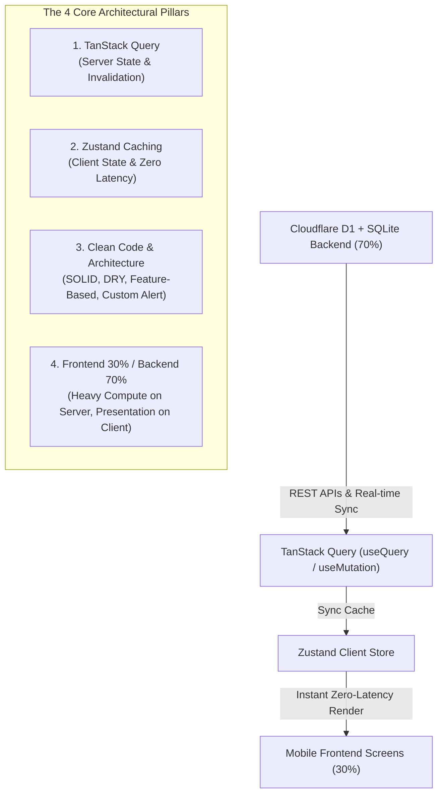
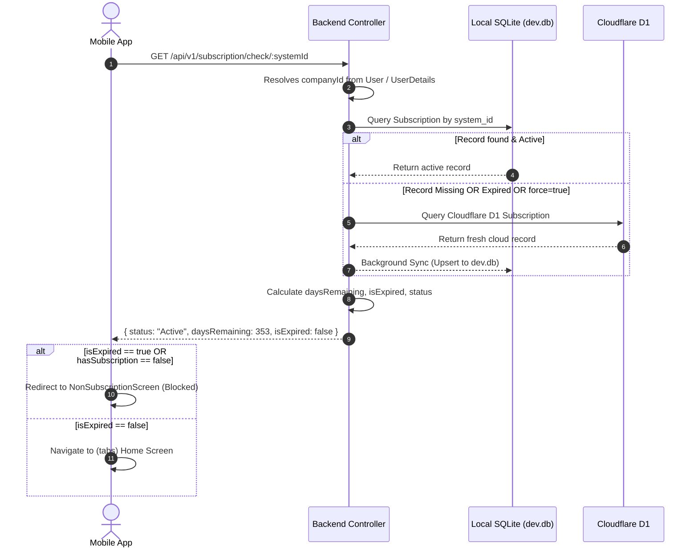

# System Architecture & Development Standards

This document establishes the architectural standards, clean code principles, folder conventions, and troubleshooting guidelines for the **SSH Group Staff App**.

---

## 1. The 4 Core Architectural Pillars



### Pillar 1: TanStack Query (Server State Management)

- **Central Query Keys Factory**: All query keys must be generated via [queryKeys.ts](file:///d:/Code/SSH-Group-Staff-App/app/frontend/src/shared/services/api/queryKeys.ts) (`queryKeys.subscription.check()`, `queryKeys.staff.all`, `queryKeys.home.all`, `queryKeys.systemConfig.all`). Never use loose string keys.
- **Cache Invalidation on Mutation**: When any mutating operation succeeds (creating a staff, terminating a session, saving profile info), the mutation hook must trigger `queryClient.invalidateQueries(...)` to guarantee real-time data consistency across all screens without full page reloads.
- **Rogue `useEffect` Elimination**: Never execute `apiClient.get` inside a component's `useEffect`. All server reads must be encapsulated in TanStack Query hooks (`useQuery`).

### Pillar 2: Zustand Caching (Client-Side State & Zero Latency)

- Every domain feature maintains a dedicated Zustand store (`useSubscriptionStore`, `useHomeStore`, `useDevicesStore`, `useStaffDirectoryStore`, `useInformationStore`, `useCompanyInfoStore`, `useSystemConfigStore`).
- **Instant UI Render**: Screens read from the Zustand cache immediately upon mounting, rendering cached content with zero loading spinners, while TanStack Query validates freshness in the background (stale-while-revalidate).
- **Offline Continuity**: When network connectivity drops, the client continues operating seamlessly using state persisted in Zustand and `AsyncStorage`.

### Pillar 3: Clean Code & Feature-Based Folder Structure (SOLID & DRY)

- **Standardized Feature Anatomy**:
  ```
  features/<feature-name>/
  ├── _api/          # Axios / apiClient HTTP service calls
  ├── _components/   # Presentation UI components (SRP)
  ├── _hooks/        # Custom hooks & TanStack Query wrappers
  ├── _store/        # Zustand client state store
  ├── _types/        # TypeScript DTOs & Interfaces
  ├── _utils/        # Pure helper functions
  └── index.ts       # Barrel re-export for the public feature API
  ```
- **Alert Standardization**:
  > [!IMPORTANT]
  > **React Native's native `Alert.alert` is strictly prohibited.**
  > All user dialogs, errors, confirmations, and warnings must use the shared [alert.tsx](file:///d:/Code/SSH-Group-Staff-App/app/frontend/src/shared/components/alert/alert.tsx) (`AlertModal` / `renderAlertModal`) or `logoutModal`.

### Pillar 4: Frontend 30% and Backend 70%

- **Backend (70%)**: All heavy business logic, calculations, date filtering, geofencing validations, aggregations, remote links/configurations, and external notifications (Telegram, Cloudflare R2) occur on the server.
- **Frontend (30%)**: The mobile client remains a lightweight presentation layer responsible for camera feeds, haptics, rendering charts/cards, and user input capture.

---

## 2. Feature-Based Directory Structure

The project strictly follows a domain-driven, feature-based modular packaging structure across both backend and frontend:

```
app/
├── backend/
│   └── src/
│       ├── core/               # Domain interfaces, AppError, logger
│       ├── infrastructure/     # Database (Prisma, D1), Storage (R2), Events
│       └── features/           # Domain features
│           ├── auth/           # Login, JWT issuing, password hashing
│           ├── attendance-security/ # Scanning, Geofencing, Anti-spoofing
│           ├── attendance-requests/ # Sequential ID, R2 uploads, Telegram
│           ├── reports/        # Server-side aggregations, summary math
│           ├── devices/        # Hardware session management
│           ├── server-groups/  # Server cluster & member management
│           ├── keys/           # Server SSH/Access keys management
│           ├── users/          # Staff CRUD, systemId auto-generation
│           ├── audit-logs/     # Audit repository & querying
│           ├── subscription/   # Branch validity, plan evaluation, D1 realtime sync
│           ├── system-config/  # Remote dynamic configuration & support channels
│           └── company/        # Branch profiles & multi-system query
└── frontend/
    └── src/
        ├── shared/             # Shared constants, styles, services, widgets
        └── features/           # Feature domains
            ├── home/           # Dashboard, Scanner, Quick Actions
            ├── attendance/     # Attendance calendar, daily logs
            ├── report/         # Reports hub
            ├── report-current-staff/    # Current staff daily/weekly/monthly/annual
            ├── report-individual-staff/ # Staff selector + report preview
            ├── report-all-staff/        # Company-wide reports
            ├── report-request-current-staff/    # Leave requests for current staff
            ├── report-request-individual-staff/ # Leave requests for individual staff
            ├── devices/        # Device session manager
            ├── setting/        # Profile, settings
            ├── login/          # Auth login form & mutations
            ├── language/       # i18n store, useLanguage hook, Khmer/English locales
            ├── create-account-staff/    # Admin staff creation with Auto System ID
            ├── change-info-account-staff/ # Admin staff info editor & role switcher
            ├── server-groups/  # Server cluster management UI
            ├── keys/           # Access key upload & list UI
            ├── subscription/   # Branch service package info & validity display
            ├── non-subscription/ # Expired subscription guard screen & support contact
            ├── system-config/  # Dynamic links & remote config integration
            ├── info-company/   # Company settings & GPS geofence configuration
            ├── information/    # Personal profile & credentials editing
            ├── account/        # Account profile overview & logout
            ├── contact/        # Official platforms & dynamic social links
            ├── privacy-policy/ # Multilingual privacy policy viewer
            └── about/          # Application information & build metadata
```

---

## 3. Subscription & Branch Guard System



- **Blocking Route**: If a branch subscription is expired or missing, the app redirects the user to the `NonSubscriptionScreen`, locking tabs access.
- **Self-Healing Realtime Sync**: If local SQLite shows an expired subscription, or if the user clicks "Check Again" (`force=true`), the backend queries Cloudflare D1. If D1 has an active renewal, it returns the active subscription immediately and updates local SQLite in the background.

---

## 4. Remote System Configuration & Dynamic Links

To adhere strictly to the 70% Backend rule, all support channels, phone numbers, email addresses, and social platform URLs are managed from the backend via the `system-config` feature:

- **Backend Endpoints**:
  - `GET /api/v1/system-config`: Fetches complete dynamic configurations.
  - `PUT /api/v1/system-config`: Allows Admin/Owner to update links remotely.
- **No Client Recompilation**: If the company updates its Telegram support channel or Facebook URL, the admin updates it in the backend database. All mobile clients reflect the update in real time without needing an App Store or Play Store update.
- **Frontend Hook**: `useSystemConfigQuery()` from `@/features/system-config` provides `{ supportLinks, socialPlatforms, appMeta }`.

---

## 5. Local Development & Troubleshooting Guide

### Issue 1: ADB Ghost Emulator / Port 5554 Connection Refused (10061)

```
Error: could not connect to TCP port 5554: cannot connect to 127.0.0.1:5554: No connection could be made because the target machine actively refused it. (10061)
Error: .../adb -s emulator-5554 emu avd name exited with non-zero code: 1
```

#### Cause:
An emulator crashed or closed abruptly, leaving a stale/ghost `emulator-5554` registration in the ADB server daemon.

#### Fix:
Restart the ADB server to clear all ghost devices:
```powershell
$adb = "$env:LOCALAPPDATA\Android\Sdk\platform-tools\adb.exe"
& $adb kill-server
& $adb start-server
& $adb devices
```
Now run your Expo build cleanly:
```powershell
cd app/frontend
npx expo run:android -d
```

---

### Issue 2: Backend Connection Refused / IP Address Mismatch

```
WARN Exception while fetching attendance config from Backend API: [ApiError: Cannot connect to server...]
```

#### Fix:
1. Ensure the backend server is running:
   ```powershell
   cd app/backend
   npm run dev
   ```
2. Verify computer IPv4 address with `ipconfig` and update `EXPO_PUBLIC_API_URL` in [app/frontend/.env.local](file:///d:/Code/SSH-Group-Staff-App/app/frontend/.env.local).
3. Restart Expo bundler with cache cleared:
   ```powershell
   cd app/frontend
   npx expo start -c
   ```
