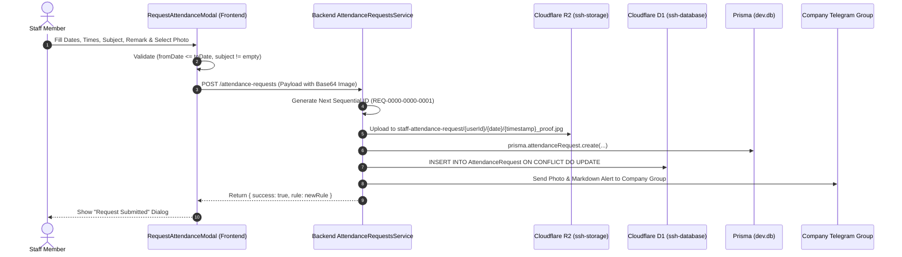

# Attendance Requests & Cloud Storage Architecture

This document outlines the end-to-end workflow, sequential ID generation, proof photo processing, and Cloudflare R2/D1 storage for attendance requests.

---

## 1. Request Lifecycle Overview



---

## 2. Sequential ID Generation Algorithm

Attendance requests follow a user-scoped, sequential 8-digit format:
```
{system_id}-REQ-0000-0001
{system_id}-REQ-0000-0002
...
```

*Examples:*
- User `system-0001-0022`:
  - `system-0001-0022-REQ-0000-0001`
  - `system-0001-0022-REQ-0000-0002`
- User `system-0002-0001`:
  - `system-0002-0001-REQ-0000-0001`
  - `system-0002-0001-REQ-0000-0002`
- User `system-0002-0002`:
  - `system-0002-0002-REQ-0000-0001`
- User `system-0003-0001`:
  - `system-0003-0001-REQ-0000-0001`
  - `system-0003-0001-REQ-0000-0002`

### Implementation ([attendance-requests.service.ts](file:///d:/Code/SSH-Group-Staff-App/app/backend/src/features/attendance-requests/attendance-requests.service.ts#L9-L40)):
```ts
function generateNextRequestId(
  systemId: string,
  existingRules: any[] = [],
  existingDbRecords: any[] = [],
): string {
  const cleanSystemId = (systemId || "system-0001-0000").trim();
  let maxSeq = 0;
  const allRecords = [...existingRules, ...existingDbRecords];

  for (const r of allRecords) {
    if (r?.id && typeof r.id === "string") {
      const idStr = r.id.trim();
      if (idStr.includes("REQ")) {
        const reqPart = idStr.substring(idStr.lastIndexOf("REQ"));
        const digitsOnly = reqPart.replace(/\D/g, "");
        if (digitsOnly) {
          const num = parseInt(digitsOnly, 10);
          if (!isNaN(num) && num > maxSeq && num < 100000000) {
            maxSeq = num;
          }
        }
      }
    }
  }

  const nextSeq = maxSeq + 1;
  const seqStr = String(nextSeq).padStart(8, "0");
  const block1 = seqStr.substring(0, 4);
  const block2 = seqStr.substring(4, 8);

  return `${cleanSystemId}-REQ-${block1}-${block2}`;
}
```

---

## 3. Proof Photo Storage (Cloudflare R2)

### Bucket & Key Specifications
- **Bucket**: `ssh-storage`
- **Key Pattern**:
  ```
  staff-attendance-request/{system_id_or_userId}/{created_date}/{timestamp}_proof.{ext}
  ```
  *Note:* The `{created_date}` folder is always the **current calendar date when the file is created** (e.g. `2026-11-07`), not the requested leave date (`fromDate`).
  *Example*: `staff-attendance-request/system-0002-0001/2026-11-07/1794037241029_proof.jpg`

### Resilient Base64 Pipeline
1. **Client-Side Fallback** ([useRequestAttendanceForm.ts](file:///d:/Code/SSH-Group-Staff-App/app/frontend/src/features/home/_hooks/useRequestAttendanceForm.ts#L150-L165)):
   If `expo-image-picker` does not return `asset.base64`, the file is read directly from disk via `expo-file-system` (`FileSystem.readAsStringAsync`).
2. **Server-Side Normalization** ([attendance-requests.service.ts](file:///d:/Code/SSH-Group-Staff-App/app/backend/src/features/attendance-requests/attendance-requests.service.ts#L108-L135)):
   Strips data URI prefixes, cleans whitespace and newline characters, determines proper MIME type (`image/jpeg`, `image/png`, `image/webp`), and uploads as binary buffer using `@aws-sdk/client-s3`.

---

## 4. Dual Persistence Architecture

Every created request is saved to two database stores:

### 1. Prisma ORM (`dev.db`):
```ts
await prisma.attendanceRequest.create({
  data: {
    id: newRuleId,
    userId: user.systemId,
    subject: subject.trim(),
    remark: remark.trim(),
    status: "pending",
    fromDate: fromDate,
    fromTime: fromTime,
    toDate: toDate,
    toTime: toTime,
    createdAt: now,
  },
});
```

### 2. Cloudflare D1 (`ssh-database`):
```sql
INSERT INTO AttendanceRequest (
  id, userId, subject, remark, status, fromDate, fromTime, toDate, toTime, createdAt
) VALUES (?, ?, ?, ?, ?, ?, ?, ?, ?, ?)
ON CONFLICT(id) DO UPDATE SET
  subject = excluded.subject,
  remark = excluded.remark,
  status = excluded.status,
  fromDate = excluded.fromDate,
  fromTime = excluded.fromTime,
  toDate = excluded.toDate,
  toTime = excluded.toTime;
```

---

## 5. Telegram Photo Alert Dispatch (Matching Attendance Scan Alert)

When an attendance request is submitted with a proof photo:
1. The binary image buffer is packaged into a native `FormData` multipart payload with `Blob`.
2. It calls Telegram API `POST /bot<TOKEN>/sendPhoto`.
3. The image is rendered directly in the chat with the formatted HTML caption (identical to Attendance Scan Alerts):

```html
📝 <b>New Attendance Request Submitted</b>
🆔 <b>Staff ID:</b> bpak-0001
👤 <b>Staff:</b> BPAK BROSSPICH
📌 <b>Subject:</b> Work Outside
📅 <b>From:</b> 2026-11-08 8:00 AM
📅 <b>To:</b> 2026-11-08 5:00 PM
💬 <b>Remark:</b> at PP Centre
⏳ <b>Status:</b> 🟡 PENDING
📷 <b>Proof Image:</b> [Photo Attached]
```

If no proof photo is attached, it gracefully falls back to `POST /bot<TOKEN>/sendMessage`.
