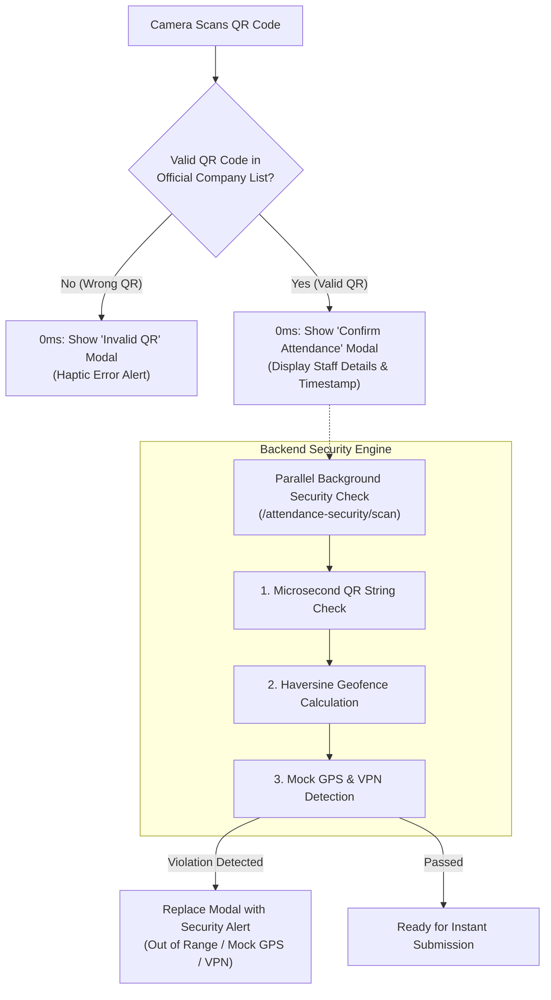

# Attendance Security & Geofence Verification Engine

This document details the multi-layered security architecture, 0ms ultra-fast QR scanning, anti-spoofing algorithms, and in-memory caching mechanisms used for attendance verification.

---

## 1. Multi-Layer Security Architecture

Attendance verification operates across two cooperative layers:
1. **Client-Side (0ms Instant Feedback)**: Evaluates QR integrity locally against official branch QR lists, instantly launching the confirmation or invalid modal without waiting for a server roundtrip.
2. **Server-Side (Deep Security Check)**: Validates coordinates against branch geofences using the Haversine formula, verifies mock location flags, checks VPN heuristics, and verifies device session legitimacy.



---

## 2. 0ms Instant QR Verification Pipeline

### Client-Side Pre-Warming ([HomeScreen.tsx](file:///d:/Code/SSH-Group-Staff-App/app/frontend/src/features/home/HomeScreen.tsx#L40-L45))
When `HomeScreen` mounts, it calls `prewarmDeviceGps()` in the background. By the time the user opens the camera and aligns the QR code, high-accuracy GPS coordinates are already cached in memory.

### Fast Scanner Hook ([useHomeScanner.ts](file:///d:/Code/SSH-Group-Staff-App/app/frontend/src/features/home/_hooks/useHomeScanner.ts))
1. **Invalid QR**: If the scanned text is not in `officialQrList`, an error haptic is triggered and the `InvalidQrModal` is shown in 0ms.
2. **Valid QR**: Generates an optimistic `previewRecord` with current time and staff details, displaying the `Confirm Attendance` modal in 0ms.
3. **Background Validation**: Dispatches `/attendance-security/scan` concurrently. If a security rule fails (e.g. out of office), the Confirm modal is replaced with the security warning.

---

## 3. Geofencing Algorithm (Haversine Formula)

The backend calculates the exact distance between the staff member's device coordinates and the company's registered locations.

### Mathematical Formula:
$$\Delta\text{lat} = \text{lat}_2 - \text{lat}_1$$
$$\Delta\text{lon} = \text{lon}_2 - \text{lon}_1$$
$$a = \sin^2\left(\frac{\Delta\text{lat}}{2}\right) + \cos(\text{lat}_1) \cdot \cos(\text{lat}_2) \cdot \sin^2\left(\frac{\Delta\text{lon}}{2}\right)$$
$$c = 2 \cdot \text{atan2}\left(\sqrt{a}, \sqrt{1 - a}\right)$$
$$d = R \cdot c \quad (\text{where } R = 6,371,000 \text{ meters})$$

### Implementation ([attendance-security.service.ts](file:///d:/Code/SSH-Group-Staff-App/app/backend/src/features/attendance-security/attendance-security.service.ts)):
```ts
function calculateHaversineDistance(
  lat1: number,
  lon1: number,
  lat2: number,
  lon2: number,
): number {
  const R = 6371e3; // Earth radius in meters
  const dLat = ((lat2 - lat1) * Math.PI) / 180;
  const dLon = ((lon2 - lon1) * Math.PI) / 180;
  const a =
    Math.sin(dLat / 2) * Math.sin(dLat / 2) +
    Math.cos((lat1 * Math.PI) / 180) *
      Math.cos((lat2 * Math.PI) / 180) *
      Math.sin(dLon / 2) *
      Math.sin(dLon / 2);
  const c = 2 * Math.atan2(Math.sqrt(a), Math.sqrt(1 - a));
  return R * c;
}
```

---

## 4. Anti-Spoofing & Integrity Verification

1. **Mock GPS Detection**: Checks native Android/iOS `isMocked` and `mocked` attributes from `expo-location`.
2. **VPN Detection**: Analyzes network interfaces for `tun0`, `ppp0`, `p2p0`, and known commercial VPN subnet prefixes.
3. **Hardware Session Integrity**: Validates `DeviceSession` to ensure the scanning device matches the active device ID registered to the user account.

---

## 5. High-Performance Caching Strategy

To achieve sub-50ms server responses, multiple in-memory caches with Time-To-Live (TTL) are maintained:

| Cache Name | TTL | Stored Value | Purpose |
| :--- | :--- | :--- | :--- |
| `cachedDeviceGps` (Frontend) | 3 Minutes | `{ lat, lng, isMocked }` | Eliminates 2-second GPS acquisition delay during scans |
| `companyCoordsCache` (Backend) | 30 Minutes | Parsed Branch Geofence Coordinates | Avoids parsing location strings on every scan |
| `companyCache` (Backend) | 10 Minutes | Company DB Record & Bot Tokens | Eliminates redundant Prisma/D1 company queries |
| `userCache` (Backend) | 5 Minutes | User Details & System ID mapping | Instant staff identity resolution |

---

## 6. Standardized Attendance Record ID Pattern

All attendance records across Cloudflare D1 (`AttendanceLog`), SQLite, and user JSON stores follow a strict, human-readable, and sequential format scoped per staff user:

$$\text{Format: } \mathbf{\{system\_id\}\text{-ATT-}\text{0000-0001}}$$

### Examples:
- Staff `system-0001-0022`:
  - `system-0001-0022-ATT-0000-0001`
  - `system-0001-0022-ATT-0000-0002`
  - `system-0001-0022-ATT-0000-0003`
- Staff `system-0002-0001`:
  - `system-0002-0001-ATT-0000-0001`
  - `system-0002-0001-ATT-0000-0002`
- Staff `system-0002-0002`:
  - `system-0002-0002-ATT-0000-0001`
- Staff `system-0003-0001`:
  - `system-0003-0001-ATT-0000-0001`
  - `system-0003-0001-ATT-0000-0002`

### Scoping & Generation Rules:
1. **User-Scoped Sequence**: The sequence counter (`0000-0001`, `0000-0002`, etc.) resets per staff user. User A's logs do not advance User B's count.
2. **Synchronized DB Check**: Before generating the next ID, both local Prisma SQLite and Cloudflare D1 are queried for the staff member's highest existing sequence.
3. **Upsert Safety**: Writes to both D1 (`INSERT OR REPLACE INTO AttendanceLog`) and Prisma (`prisma.attendanceLog.upsert`) use `id: nextId` as the unique primary key.
