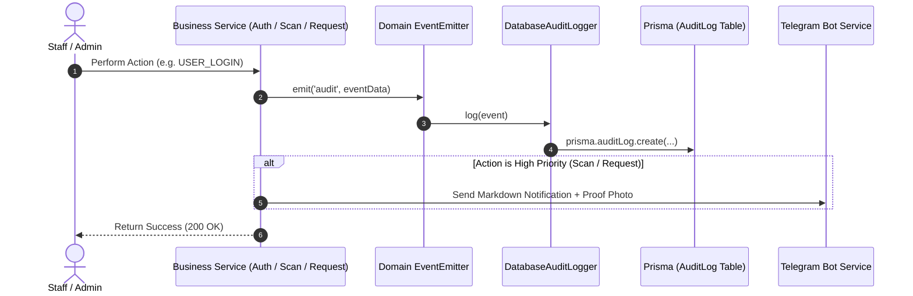

# Audit Logging & Event Tracking System

This document outlines the architecture, data models, event emitter lifecycle, and alerting integrations for audit logs in the **SSH Group Staff Management System**.

---

## 1. Audit Logging Architecture

The system uses an event-driven architecture to decouple operational business logic from persistence and notifications.



---

## 2. Audit Log Data Model

Defined in [app/backend/prisma/schema.prisma](file:///d:/Code/SSH-Group-Staff-App/app/backend/prisma/schema.prisma#L139-L148):

```prisma
model AuditLog {
  id        String   @id @default(uuid())
  action    String   // Canonical Action Name (e.g., USER_LOGIN)
  actorId   String   // System ID of the user performing the action
  actorName String   // Name or username of the actor
  targetId  String?  // Target resource ID (e.g., Device ID, User ID)
  details   String?  // JSON stringified context payload
  ipAddress String?  // Client IP address (captured from req headers)
  createdAt DateTime @default(now()) @map("timestamp")
}
```

---

## 3. Canonical Actions Tracked

| Action | Trigger Description | Logged Details |
| :--- | :--- | :--- |
| `USER_LOGIN` | Staff successfully logs into the mobile app or portal | Device Name, Model, OS, App Version, IP |
| `USER_LOGOUT` | Staff manually logs out or session terminates | Session ID, Logout Timestamp |
| `ATTENDANCE_SCAN` | Staff successfully scans an official QR code | Scan Type (`TIME_IN`, `TIME_OUT`), Company ID, Distance (m), R2 Photo URL |
| `ATTENDANCE_SECURITY_REJECT` | Scan rejected due to mock GPS, VPN, or out of geofence | Geofence distance, spoofing flags, IP |
| `ATTENDANCE_REQUEST_CREATED` | Staff submits missing attendance or leave request | `REQ-ID`, Date range, Subject, Remark, R2 Photo URL |
| `DEVICE_TERMINATED` | Active device session terminated by user or admin | Target Device ID, Reason |
| `STAFF_PROFILE_UPDATED` | Profile details (name, email, phone) modified | Changed fields, Actor ID |

---

## 4. Implementation Details

### Database Audit Logger ([eventEmitter.ts](file:///d:/Code/SSH-Group-Staff-App/app/backend/src/infrastructure/events/eventEmitter.ts))
```ts
export class DatabaseAuditLogger implements IAuditLogger {
  async log(event: AuditEvent): Promise<void> {
    try {
      await prisma.auditLog.create({
        data: {
          action: event.action,
          actorId: event.actorId,
          actorName: event.actorName,
          targetId: event.targetId,
          details: event.details ? JSON.stringify(event.details) : undefined,
          ipAddress: event.ipAddress,
        },
      });
      Logger.info(`Audit logged: ${event.action} by ${event.actorName}`);
    } catch (err) {
      Logger.error("Failed to persist audit log to database", err);
    }
  }
}
```

### Capturing Client IP Address
In Express controllers, client IP is extracted from proxy headers:
```ts
const ipAddress =
  (req.headers["x-forwarded-for"] as string)?.split(",")[0]?.trim() ||
  req.socket.remoteAddress ||
  "unknown";
```

---

## 5. Telegram Alerting Integration

When critical operations occur, the system automatically posts formatted Telegram alerts to the designated branch Telegram group.

### Handled in:
- [attendance-security.service.ts](file:///d:/Code/SSH-Group-Staff-App/app/backend/src/features/attendance-security/attendance-security.service.ts) (Attendance Scans)
- [attendance-requests.service.ts](file:///d:/Code/SSH-Group-Staff-App/app/backend/src/features/attendance-requests/attendance-requests.service.ts) (Attendance Requests)

### Features:
1. **Multipart Photo Upload**: Sends proof photo as a Telegram `sendPhoto` multipart form along with the caption.
2. **Formatted Markdown**: Bold headers, staff ID, position, timestamps, and clickable Google Maps location links.
3. **Resilience**: Runs asynchronously in background; failure to reach Telegram never blocks or fails the user's scan or request submission.

---

## 6. Audit Query API Endpoints

| Method | Endpoint | Query Parameters | Description |
| :--- | :--- | :--- | :--- |
| `GET` | `/audit-logs` | `action`, `actorId`, `limit`, `offset` | Retrieve paginated audit logs with optional filters |
| `GET` | `/audit-logs/:id` | `id` | Retrieve single audit log entry by UUID |
