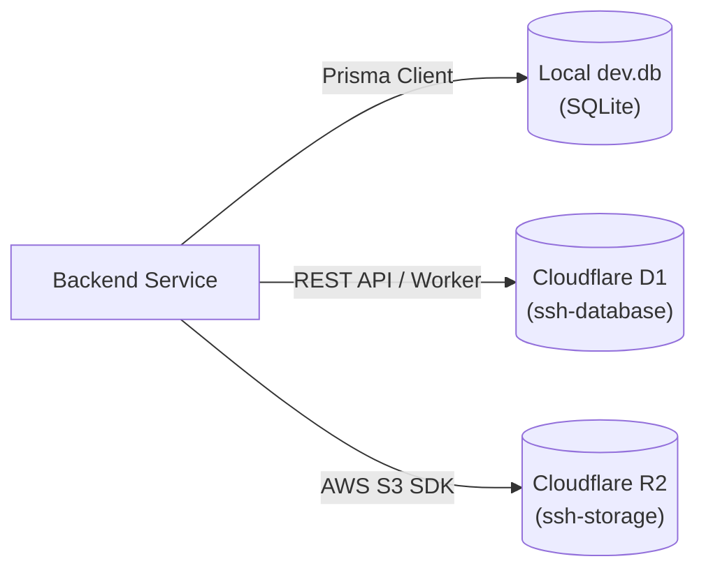
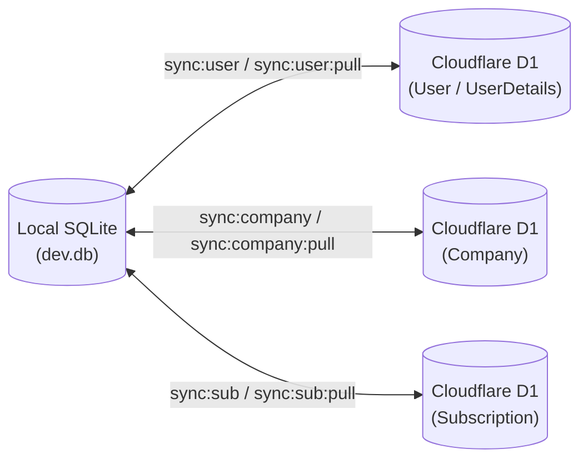

# Database & Storage Architecture

This document details the database models, relations, synchronization strategy, and object storage integration for the **SSH Group Staff Management System**.

---

## 1. Dual Database Strategy

The system utilizes a hybrid, high-availability data storage strategy:

1. **Local Relational DB (Prisma + SQLite `dev.db`)**:
   - Used by the Node.js backend for high-speed transactions, relations, and local development.
   - Defined in [prisma/schema.prisma](file:///d:/Code/SSH-Group-Staff-App/app/backend/prisma/schema.prisma).
2. **Cloudflare D1 Distributed SQLite (`ssh-database`)**:
   - Cloud-native serverless SQL database running globally at the Cloudflare edge.
   - Accessed via [d1Client.ts](file:///d:/Code/SSH-Group-Staff-App/app/backend/src/infrastructure/database/d1Client.ts).
   - Serves as the remote source of truth for attendance logs, attendance requests, and staff data across branches.



---

## 2. Entity Relational Schema (Prisma)

### `User` & `UserDetails` (Staff Profiles)

Separates authentication credentials from mutable staff personal information.

> [!NOTE]
> **Per-System Username Uniqueness**: Usernames are scoped per branch/system (`companyId`). Multiple systems can have the same username (e.g., `test` in `system-0001` and `test` in `system-0002`), but within the same system, usernames must be unique. The global `@unique` constraint was removed in Migration 14 for both Cloudflare D1 and local SQLite.

```prisma
model User {
  systemId            String              @id @map("system_id") // e.g. "system-0001-0022", "system-0002-0001"
  id                  String              // Staff ID e.g. "0022", "bpak-0001"
  username            String              // Scoped unique per system
  passwordHash        String
  role                String              @default("member")
  isActive            Boolean             @default(true) // Stored as INTEGER (1 or 0) in Cloudflare D1
  createdAt           DateTime            @default(now())
  updatedAt           DateTime            @updatedAt

  details             UserDetails?
  attendanceLogs      AttendanceLog[]
  attendanceRequests  AttendanceRequest[]
  deviceSessions      DeviceSession[]
}

model UserDetails {
  systemId    String    @id @map("system_id")
  companyId   String?   @map("company_id") // Foreign key to Company(id)
  name        String?
  email       String?
  phone       String?
  position    String?
  dob         String?
  joined      String?
  createdAt   DateTime  @default(now())
  updatedAt   DateTime  @updatedAt

  user        User      @relation(fields: [systemId], references: [systemId], onDelete: Cascade)
  company     Company?  @relation(fields: [companyId], references: [id])
}
```

### `Company` (Branch & Geofence Coordinates)

Stores branch configuration, official work hours, and geofence locations.

```prisma
model Company {
  id               String          @id // e.g. "system-0001", "system-0002"
  name             String
  qrCodes          String?         // JSON array of valid QR codes
  location         String?         // JSON array of Google Maps coordinates / links
  telegramBotToken String?
  telegramChatId   String?
  timeIn           String?         // e.g. "08:00 AM"
  timeOut          String?         // e.g. "05:00 PM"
  createdAt        DateTime        @default(now())
  updatedAt        DateTime        @updatedAt
  userDetails      UserDetails[]
  attendanceLogs   AttendanceLog[]
}
```

### `AttendanceLog` (Clock In / Out Records)

Immutable record of an attendance event scanned by staff.

```prisma
model AttendanceLog {
  id         String   @id // e.g. "system-0001-0022-ATT-0000-0001" (User-scoped sequential)
  userId     String
  companyId  String?
  scanDate   String   // "YYYY-MM-DD"
  scanTime   String   // "HH:MM:SS AM/PM"
  type       String   // 'TIME_IN', 'TIME_OUT', 'TIME_OTHER'
  qrData     String?
  image      String?  // Cloudflare R2 Public URL
  remark     String?
  createdAt  DateTime @default(now())
  user       User     @relation(fields: [userId], references: [systemId], onDelete: Cascade)
  company    Company? @relation(fields: [companyId], references: [id])
}
```

### `AttendanceRequest` (Leave / Missing Scan Requests)

Stores attendance requests created by staff for review and approval.

```prisma
model AttendanceRequest {
  id        String   @id // e.g. "system-0001-0022-REQ-0000-0001" (User-scoped sequential)
  userId    String
  subject   String
  remark    String?
  status    String   @default("pending") // 'pending', 'approved', 'rejected'
  fromDate  String?  // "YYYY-MM-DD"
  fromTime  String?  // "HH:MM AM/PM"
  toDate    String?  // "YYYY-MM-DD"
  toTime    String?  // "HH:MM AM/PM"
  createdAt DateTime @default(now())
  user      User     @relation(fields: [userId], references: [systemId], onDelete: Cascade)
}
```

### `DeviceSession` (Hardware & Security Binding)

Tracks devices logged into staff accounts to prevent multi-device credential sharing.

```prisma
model DeviceSession {
  id           String   @id // UUID / Unique Device ID
  userId       String
  deviceName   String?
  modelName    String?
  os           String?
  osVersion    String?
  appVersion   String?
  ipAddress    String?
  location     String?  // "Lat, Long"
  isTerminated Int      @default(0) // 0 = active, 1 = terminated
  lastActive   DateTime @default(now())
  lastLogin    DateTime @default(now())
  user         User     @relation(fields: [userId], references: [systemId], onDelete: Cascade)
}
```

### `ServerGroup`, `ServerKey` & `GroupMember` (Infrastructure & Key Management)

Replaced the legacy `SSHGroup` model to support server cluster organization, access keys, and role-based server access.

```prisma
model ServerGroup {
  id          String        @id @default(uuid())
  name        String
  description String?
  color       String?
  createdAt   DateTime      @default(now())
  updatedAt   DateTime      @updatedAt
  members     GroupMember[]
}

model GroupMember {
  id          String      @id @default(uuid())
  groupId     String
  userId      String
  role        String      @default("MEMBER")
  createdAt   DateTime    @default(now())
  group       ServerGroup @relation(fields: [groupId], references: [id], onDelete: Cascade)
}

model ServerKey {
  id          String    @id @default(uuid())
  title       String
  keyContent  String
  type        String    @default("RSA")
  fingerprint String?
  userId      String
  createdAt   DateTime  @default(now())
  updatedAt   DateTime  @updatedAt
}
```

### `AuditLog` (System & Security Audit Trail)

Append-only log for all compliance and administrative events.

```prisma
model AuditLog {
  id        String   @id @default(uuid())
  action    String   // e.g. "USER_LOGIN", "ATTENDANCE_SCAN", "DEVICE_TERMINATED"
  actorId   String
  actorName String
  targetId  String?
  details   String?  // Stringified JSON payload
  ipAddress String?
  createdAt DateTime @default(now()) @map("timestamp")
}
```

---

## 3. Cloudflare R2 Object Storage Integration

Proof photos submitted during attendance scans, attendance requests, and staff avatars are stored in Cloudflare R2 bucket `ssh-storage`.

### Configuration ([.env](file:///d:/Code/SSH-Group-Staff-App/app/backend/.env))

```ini
R2_ACCOUNT_ID="9a061f4a584c2e1727526b1006284098"
R2_ACCESS_KEY_ID="3d63b20e53c7b64517d1e92217dba458"
R2_SECRET_ACCESS_KEY="<SECRET_ACCESS_KEY>"
R2_BUCKET_NAME="ssh-storage"
```

### Storage Directory Structure

All objects are systematically namespaced to guarantee 0 collisions:

```
ssh-storage/
├── staff-attendance/
│   └── {system_id_or_userId}/
│       └── {YYYY-MM-DD}/
│           └── {timestamp}_proof.jpg
├── staff-attendance-request/
│   └── {system_id_or_userId}/
│       └── {YYYY-MM-DD}/
│           └── {timestamp}_proof.jpg
└── staff-avatars/
    └── {system_id_or_userId}/
        └── avatar_{timestamp}.jpg
```

### `Subscription` (Branch Service Validity)

Manages system access subscription per company branch (`systemId`):

```prisma
model Subscription {
  id        String   @id // e.g. "SUB-0001", "SUB-0002"
  systemId  String   @map("system_id") // Matches Company.id e.g. "system-0001"
  plan      String   // e.g. "1 Year", "6 Months"
  startDate String   @map("start_date") // YYYY-MM-DD
  endDate   String   @map("end_date") // YYYY-MM-DD
  createdAt DateTime @default(now())

  @@index([systemId])
}
```

### `SystemConfig` (Dynamic Remote Configuration)

Stores dynamic settings, support links, and social platforms:

```sql
CREATE TABLE IF NOT EXISTS SystemConfig (
  key TEXT PRIMARY KEY,
  value TEXT NOT NULL,
  updatedAt DATETIME DEFAULT CURRENT_TIMESTAMP
);
```

---

## 4. Live Data Routing & Dual-Database Sync

The application operates an active-active sync model between **Cloudflare D1**, **Cloudflare R2**, and local **SQLite (`dev.db`)**:

| Action                 | Cloudflare D1 (Cloud DB) | Cloudflare R2 (Files/Photos)              | Local DB (`dev.db`)   | Notifications  |
| :--------------------- | :----------------------- | :---------------------------------------- | :-------------------- | :------------- |
| **Create User**        | `User`, `UserDetails`    | Avatar photo (if uploaded)                | `User`, `UserDetails` | Audit Log      |
| **Edit User**          | `User`, `UserDetails`    | Updated avatar photo                      | `User`, `UserDetails` | Audit Log      |
| **Scan Attendance**    | `AttendanceLog`          | Proof photo (`staff-attendance/`)         | `AttendanceLog`       | Telegram Alert |
| **Request Attendance** | `AttendanceRequest`      | Proof photo (`staff-attendance-request/`) | `AttendanceRequest`   | Telegram Alert |

### Synchronization Flow:

1. **Primary Cloud Write**: User, Attendance, and Request actions write directly to **Cloudflare D1** via [d1Client.ts](file:///d:/Code/SSH-Group-Staff-App/app/backend/src/infrastructure/database/d1Client.ts).
2. **Object Upload**: Base64/binary photos are uploaded to **Cloudflare R2** via [r2.service.ts](file:///d:/Code/SSH-Group-Staff-App/app/backend/src/infrastructure/storage/r2.service.ts) and the generated public URL is attached to the record.
3. **Local Cache / Fallback**: The backend simultaneously syncs records into local SQLite (`dev.db`) via Prisma Client. If network or remote latency occurs, local data provides immediate continuity.

---

## 5. Bi-Directional Synchronization Scripts

The backend provides CLI scripts to synchronize records between local SQLite (`dev.db`) and Cloudflare D1 in either direction:



### Available Synchronization Commands:

| Command | Direction | Tables Synchronized | Script File |
| :--- | :--- | :--- | :--- |
| `npm run sync:sub` | Local -> D1 | `Subscription` | [sync_subscription_to_d1.js](file:///d:/Code/SSH-Group-Staff-App/app/backend/scripts/sync_subscription_to_d1.js) |
| `npm run sync:sub:pull` | D1 -> Local | `Subscription` | [sync_d1_subscription_to_local.js](file:///d:/Code/SSH-Group-Staff-App/app/backend/scripts/sync_d1_subscription_to_local.js) |
| `npm run sync:user` | Local -> D1 | `User`, `UserDetails` | [sync_user_to_d1.js](file:///d:/Code/SSH-Group-Staff-App/app/backend/scripts/sync_user_to_d1.js) |
| `npm run sync:user:pull` | D1 -> Local | `User`, `UserDetails` | [sync_user_to_local.js](file:///d:/Code/SSH-Group-Staff-App/app/backend/scripts/sync_user_to_local.js) |
| `npm run sync:company` | Local -> D1 | `Company` | [sync_company_to_d1.js](file:///d:/Code/SSH-Group-Staff-App/app/backend/scripts/sync_company_to_d1.js) |
| `npm run sync:company:pull` | D1 -> Local | `Company` | [sync_company_to_local.js](file:///d:/Code/SSH-Group-Staff-App/app/backend/scripts/sync_company_to_local.js) |

