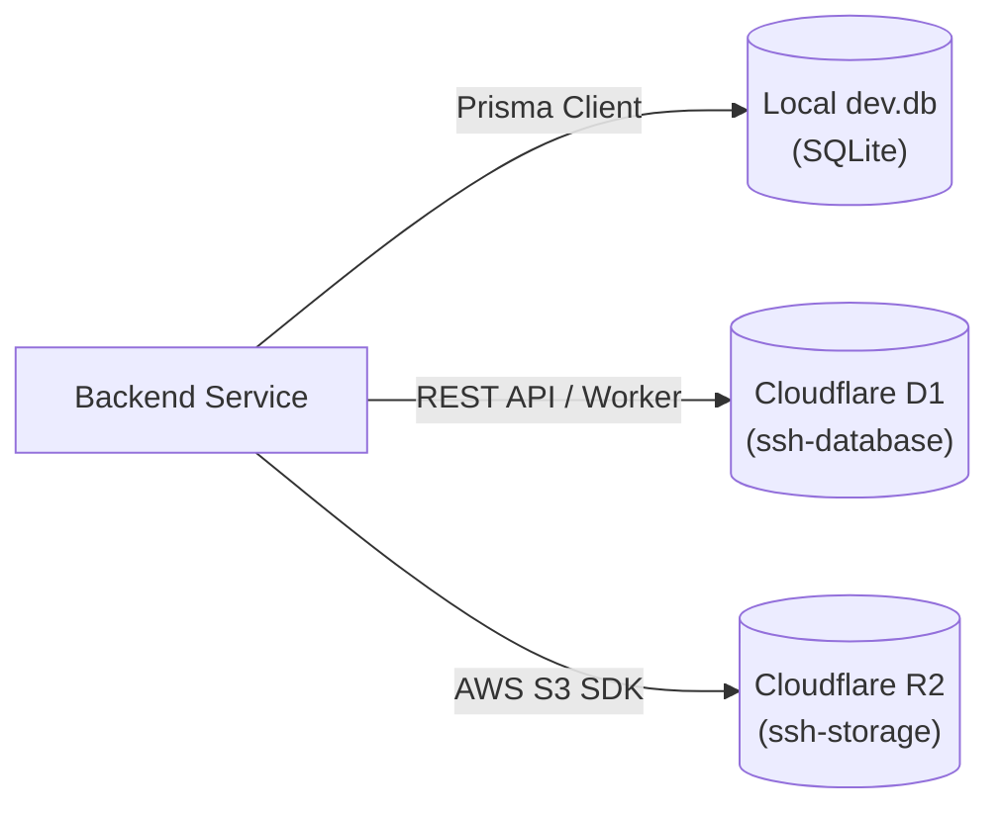

# Database & Storage Architecture

This document details the database models, relations, synchronization strategy, and object storage integration for the **SSH Group Staff Management System**.

---

## 1. Dual Database Strategy

The system utilizes a hybrid, high-availability data storage strategy:

1. **Local Relational DB (Prisma + SQLite `dev.db`)**:
   - Used by the Node.js backend for high-speed transactions, relations, and local development.
   - Defined in [prisma/schema.prisma](file:///d:/Code/SSH-Group-Staff-App/app/backend/prisma/schema.prisma).
2. **Cloudflare D1 Distributed SQLite (`ssh-database`)**:
   - Cloud-native serverless SQL database running globally at the Cloudflare edge.
   - Accessed via [d1Client.ts](file:///d:/Code/SSH-Group-Staff-App/app/backend/src/infrastructure/database/d1Client.ts).
   - Serves as the remote source of truth for attendance logs, attendance requests, and staff data across branches.



---

## 2. Entity Relational Schema (Prisma)

### `User` & `UserDetails` (Staff Profiles)
Separates authentication credentials from mutable staff personal information.

```prisma
model User {
  systemId            String              @id @map("system_id") // e.g. "system-0001-0022"
  id                  String              // Staff ID e.g. "0022", "bpak-0001"
  username            String              @unique
  passwordHash        String
  role                String              @default("member")
  isActive            Boolean             @default(true)
  createdAt           DateTime            @default(now())
  updatedAt           DateTime            @updatedAt

  details             UserDetails?
  attendanceLogs      AttendanceLog[]
  attendanceRequests  AttendanceRequest[]
  deviceSessions      DeviceSession[]
}

model UserDetails {
  systemId    String    @id @map("system_id")
  companyId   String?   @map("company_id")
  name        String?
  email       String?
  phone       String?
  position    String?
  dob         String?
  joined      String?
  createdAt   DateTime  @default(now())
  updatedAt   DateTime  @updatedAt

  user        User      @relation(fields: [systemId], references: [systemId], onDelete: Cascade)
  company     Company?  @relation(fields: [companyId], references: [id])
}
```

### `Company` (Branch & Geofence Coordinates)
Stores branch configuration, official work hours, and geofence locations.

```prisma
model Company {
  id               String          @id // e.g. "system-0001", "system-0002"
  name             String
  qrCodes          String?         // JSON array of valid QR codes
  location         String?         // JSON array of Google Maps coordinates / links
  telegramBotToken String?
  telegramChatId   String?
  timeIn           String?         // e.g. "08:00 AM"
  timeOut          String?         // e.g. "05:00 PM"
  createdAt        DateTime        @default(now())
  updatedAt        DateTime        @updatedAt
  userDetails      UserDetails[]
  attendanceLogs   AttendanceLog[]
}
```

### `AttendanceLog` (Clock In / Out Records)
Immutable record of an attendance event scanned by staff.

```prisma
model AttendanceLog {
  id         String   @id // e.g. "system-0001-0022-ATT-0000-0001" (User-scoped sequential)
  userId     String
  companyId  String?
  scanDate   String   // "YYYY-MM-DD"
  scanTime   String   // "HH:MM:SS AM/PM"
  type       String   // 'TIME_IN', 'TIME_OUT', 'TIME_OTHER'
  qrData     String?
  image      String?  // Cloudflare R2 Public URL
  remark     String?
  createdAt  DateTime @default(now())
  user       User     @relation(fields: [userId], references: [systemId], onDelete: Cascade)
  company    Company? @relation(fields: [companyId], references: [id])
}
```

### `AttendanceRequest` (Leave / Missing Scan Requests)
Stores attendance requests created by staff for review and approval.

```prisma
model AttendanceRequest {
  id        String   @id // e.g. "system-0001-0022-REQ-0000-0001" (User-scoped sequential)
  userId    String
  subject   String
  remark    String?
  status    String   @default("pending") // 'pending', 'approved', 'rejected'
  fromDate  String?  // "YYYY-MM-DD"
  fromTime  String?  // "HH:MM AM/PM"
  toDate    String?  // "YYYY-MM-DD"
  toTime    String?  // "HH:MM AM/PM"
  createdAt DateTime @default(now())
  user      User     @relation(fields: [userId], references: [systemId], onDelete: Cascade)
}
```

### `DeviceSession` (Hardware & Security Binding)
Tracks devices logged into staff accounts to prevent multi-device credential sharing.

```prisma
model DeviceSession {
  id           String   @id // UUID / Unique Device ID
  userId       String
  deviceName   String?
  modelName    String?
  os           String?
  osVersion    String?
  appVersion   String?
  ipAddress    String?
  location     String?  // "Lat, Long"
  isTerminated Int      @default(0) // 0 = active, 1 = terminated
  lastActive   DateTime @default(now())
  lastLogin    DateTime @default(now())
  user         User     @relation(fields: [userId], references: [systemId], onDelete: Cascade)
}
```

### `AuditLog` (System & Security Audit Trail)
Append-only log for all compliance and administrative events.

```prisma
model AuditLog {
  id        String   @id @default(uuid())
  action    String   // e.g. "USER_LOGIN", "ATTENDANCE_SCAN", "DEVICE_TERMINATED"
  actorId   String
  actorName String
  targetId  String?
  details   String?  // Stringified JSON payload
  ipAddress String?
  createdAt DateTime @default(now()) @map("timestamp")
}
```

---

## 3. Cloudflare R2 Object Storage Integration

Proof photos submitted during attendance scans and attendance requests are stored in Cloudflare R2 bucket `ssh-storage`.

### Configuration ([.env](file:///d:/Code/SSH-Group-Staff-App/app/backend/.env))
```ini
R2_ACCOUNT_ID="9a061f4a584c2e1727526b1006284098"
R2_ACCESS_KEY_ID="3d63b20e53c7b64517d1e92217dba458"
R2_SECRET_ACCESS_KEY="<SECRET_ACCESS_KEY>"
R2_BUCKET_NAME="ssh-storage"
```

### Storage Directory Structure
All objects are systematically namespaced to guarantee 0 collisions:

```
ssh-storage/
├── staff-attendance/
│   └── {system_id_or_userId}/
│       └── {YYYY-MM-DD}/
│           └── {timestamp}_proof.jpg
└── staff-attendance-request/
    └── {system_id_or_userId}/
        └── {YYYY-MM-DD}/
            └── {timestamp}_proof.jpg
```

### Upload Code Convention ([attendance-requests.service.ts](file:///d:/Code/SSH-Group-Staff-App/app/backend/src/features/attendance-requests/attendance-requests.service.ts#L134-L144))
```ts
const dateStr = fromDate || new Date().toISOString().split("T")[0];
const userFolder = user.systemId || user.id;
const fileName = `${Date.now()}_proof.${ext}`;
const r2Key = `staff-attendance-request/${userFolder}/${dateStr}/${fileName}`;

storedImageUrl = await r2Storage.uploadFile(r2Key, buffer, mimeType);
```

---

## 4. Database Sync Mechanisms

When a record is inserted or updated (such as an attendance log or attendance request):
1. The record is persisted locally into SQLite via Prisma.
2. In parallel, an SQL `INSERT ... ON CONFLICT DO UPDATE` query is executed against Cloudflare D1 via [d1Client.ts](file:///d:/Code/SSH-Group-Staff-App/app/backend/src/infrastructure/database/d1Client.ts).
3. If D1 encounters network latency or transient downtime, the local Prisma database acts as a fallback buffer to avoid blocking the user.
