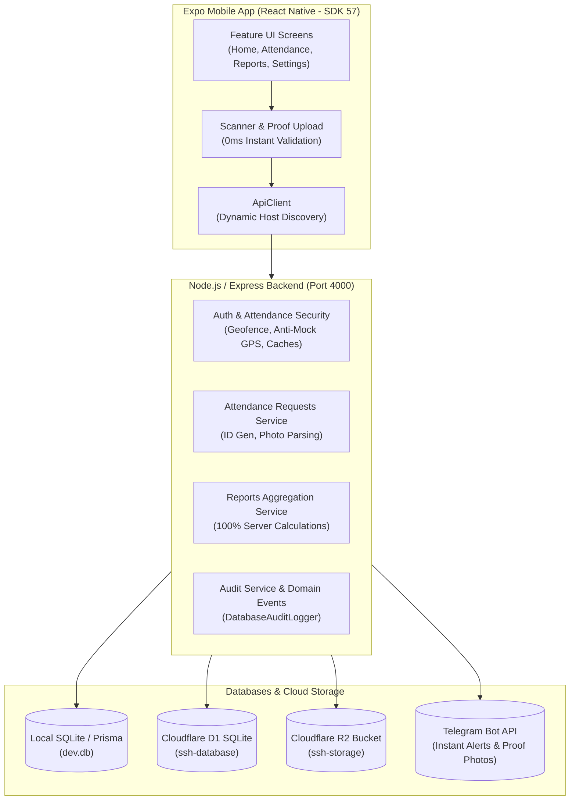

# SSH Group Staff App — Architecture & Documentation Index

Welcome to the technical documentation for the **SSH Group Staff Mobile & Backend System**.

---

## 📚 Documentation Suite

| Document | Topic & Scope |
| :--- | :--- |
| [DATABASE.md](file:///d:/Code/SSH-Group-Staff-App/docs/DATABASE.md) | **Database Architecture**: SQLite / Prisma ORM, Cloudflare D1 distributed database sync, full schema definitions, relations, and Cloudflare R2 Object Storage integration. |
| [AUDIT_LOGS.md](file:///d:/Code/SSH-Group-Staff-App/docs/AUDIT_LOGS.md) | **Audit Logging & Security Events**: Event emitter architecture, audit log schema, logged actions, actor tracking, IP capture, and Telegram alert dispatching. |
| [ATTENDANCE_SECURITY.md](file:///d:/Code/SSH-Group-Staff-App/docs/ATTENDANCE_SECURITY.md) | **Attendance Verification Engine**: 0ms instant client-side QR check, server-side geofencing (Haversine formula), anti-mock GPS, anti-VPN, and high-speed in-memory caches. |
| [ATTENDANCE_REQUESTS.md](file:///d:/Code/SSH-Group-Staff-App/docs/ATTENDANCE_REQUESTS.md) | **Attendance Requests & Storage**: Sequential ID generation (`REQ-0000-0000-0001`), R2 proof photo folder structure, image base64 processing, and approval lifecycle. |
| [REPORTS_AND_PRINTING.md](file:///d:/Code/SSH-Group-Staff-App/docs/REPORTS_AND_PRINTING.md) | **Reports & PDF Printing**: Daily, Weekly, Monthly, and Annual aggregation, HTML/PDF export, table column proportions (6/17/17/17/18/25%), and cumulative work time formatting. |
| [ARCHITECTURE_AND_STANDARDS.md](file:///d:/Code/SSH-Group-Staff-App/docs/ARCHITECTURE_AND_STANDARDS.md) | **Architecture & Coding Standards**: SOLID, DRY, Feature-Based structure, Backend 70% / Frontend 30% rule, shared components, and network/troubleshooting guide. |

---

## 🏗️ High-Level System Overview



---

## ⚡ Quick Troubleshooting

### Backend Connection Warning
If you see the warning:
```
WARN Exception while fetching attendance config from Backend API: [ApiError: Cannot connect to server. Please check your network or server status.]
```
1. Start the backend server:
   ```powershell
   cd app/backend
   npm run dev
   ```
2. Verify backend runs on `http://0.0.0.0:4000`.
3. Check `app/frontend/.env.local` matches your machine LAN IP:
   ```ini
   EXPO_PUBLIC_API_URL=http://<YOUR_LAN_IP>:4000
   ```
