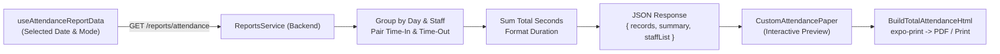

# Attendance Reports & PDF Generation Engine

This document outlines the reporting engine, server-side data aggregation, HTML/PDF generation, table column proportions, and cumulative work time formatting.

---

## 1. Reporting Architecture Overview

The reporting system strictly adheres to the **Backend 70% / Frontend 30%** rule:
- **Backend (70%)**: Fetches raw logs from D1/Prisma, filters by period (Daily, Weekly, Monthly, Annual), groups records by staff and day, calculates in/out pairings, work duration in seconds, and generates summary counts.
- **Frontend (30%)**: Renders the in-app paper preview ([CustomAttendancePaper.tsx](file:///d:/Code/SSH-Group-Staff-App/app/frontend/src/shared/components/report/CustomAttendancePaper.tsx)) and invokes native PDF rendering via `expo-print`.



---

## 2. Table Column Proportions

Both the HTML/PDF print layout ([BuildTotalAttendanceHtml.ts](file:///d:/Code/SSH-Group-Staff-App/app/frontend/src/shared/components/report/BuildTotalAttendanceHtml.ts)) and the in-app paper preview ([CustomAttendancePaper.tsx](file:///d:/Code/SSH-Group-Staff-App/app/frontend/src/shared/components/report/CustomAttendancePaper.tsx)) use identical proportional column widths.

### Single Staff View (`!isAllStaff`)
Used for Current Staff and Individual Staff reports:

| Column | Width (%) | Mobile Preview (px) | Alignment | Purpose |
| :--- | :--- | :--- | :--- | :--- |
| `#` | **6%** | 32 px | Center | Sequential row index |
| `Date` | **17%** | 92 px | Center | Date formatted `YYYY-MM-DD` |
| `Time In` | **17%** | 92 px | Center | Clock in timestamp (Blue `#0022ff`) |
| `Time Out` | **17%** | 92 px | Center | Clock out timestamp (Red `#ff0000`) |
| `Total Time` | **18%** | 96 px | Center | Work duration formatted `HH:MM:SS` |
| `Remark` | **25%** | 136 px | Center | Associated scan or edit remark |

*(Total Sum = 100%)*

### All Staff View (`isAllStaff`)
Used when generating reports across the entire company:

| Column | Width (%) | Mobile Preview (px) | Alignment |
| :--- | :--- | :--- | :--- |
| `#` | **5%** | 32 px | Center |
| `Staff ID` | **11%** | 72 px | Center |
| `Staff Name` | **Auto** | 110 px | Left / Bold |
| `Date` | **13%** | 85 px | Center |
| `Time In` | **15%** | 98 px | Center |
| `Time Out` | **15%** | 98 px | Center |
| `Total Time` | **13%** | 85 px | Center |
| `Remark` | **12%** | 78 px | Center |

---

## 3. Cumulative Total Work Time Formatting

Rather than displaying days (e.g. `00Day 05H 14M 29S`), total work time is formatted as cumulative hours, minutes, and seconds to match standard payroll formats (e.g. `05H 14M 29S` or `250H 30M 45S`):

```ts
const grandTotalSeconds = dayRows.reduce((sum, r) => sum + r.diffSeconds, 0);
const totalHours = Math.floor(grandTotalSeconds / 3600);
const remSeconds = grandTotalSeconds % 3600;
const minutes = Math.floor(remSeconds / 60);
const seconds = remSeconds % 60;

const grandHoursStr = String(totalHours).padStart(2, "0");
const grandMinsStr = String(minutes).padStart(2, "0");
const grandSecsStr = String(seconds).padStart(2, "0");
const grandTotalFormatted = `${grandHoursStr}H ${grandMinsStr}M ${grandSecsStr}S`;
```

---

## 4. Header Staff Information & Username Fallback

The report header displays verified staff identification:
```
Staff id : bpak-0001 | Staff Name : BPAK BROSSPICH | Position : Software Developer | Username : bpak
```

### Fallback Logic ([BuildTotalAttendanceHtml.ts](file:///d:/Code/SSH-Group-Staff-App/app/frontend/src/shared/components/report/BuildTotalAttendanceHtml.ts#L257-L260)):
```ts
const username =
  targetStaff?.username ||
  (records.length > 0 ? (records[0] as any).username : "") ||
  (staffId !== "-" ? staffId : "-");
```
If `targetStaff.username` is omitted from the initial query, it falls back to the record's username or the user's staff ID, preventing `-` from appearing on valid staff reports.
